# Auditoría responsive — Portal del artista ZECHE GRUV

Generado: 14/10/2026, 01:18:15 · Modo demo (Artista Demo)

## Escritorio 1920 × 1080

### Ingreso (login) — 1 hallazgos

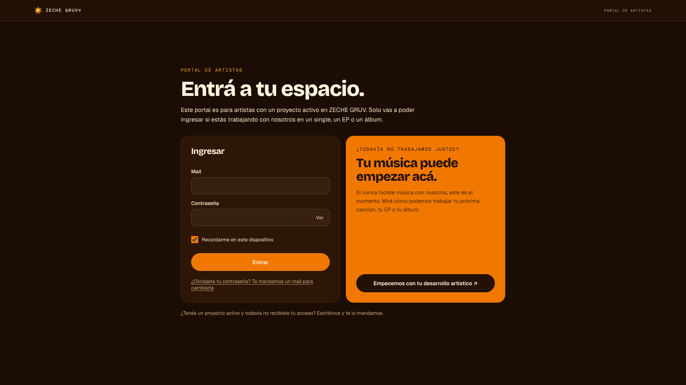

- **baja** · Texto muy chico · `span.nav-tag «PORTAL DE ARTISTAS»` — Letra de 10px.

### Mi proyecto — sin problemas

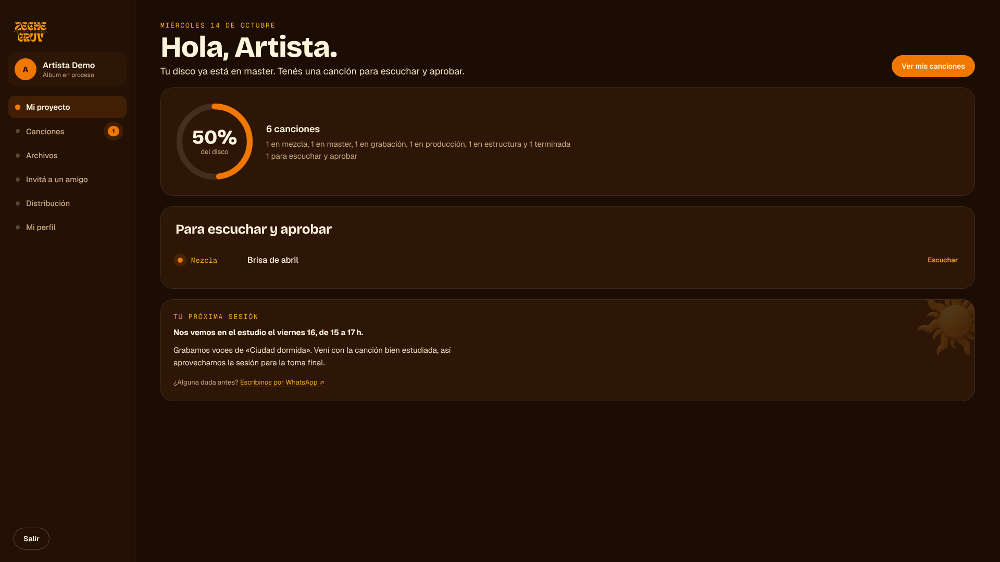

### Canciones — sin problemas

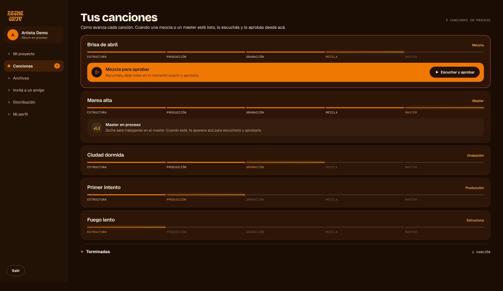

### Escuchar y aprobar (reproductor) — 11 hallazgos

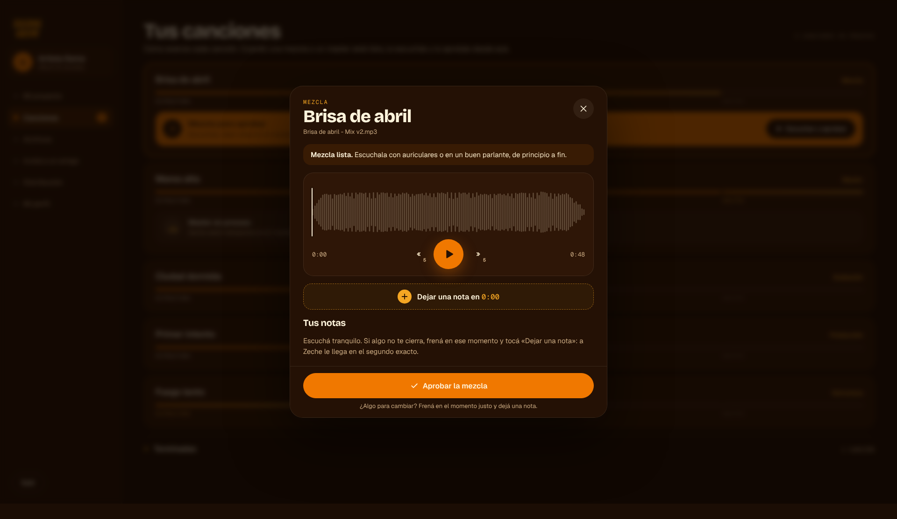

- **media** · Tapado por otro elemento · `a.nav-mark` — Lo tapa div.rv-backdrop.
- **media** · Tapado por otro elemento · `button.tab «Mi proyecto»` — Lo tapa div.rv-backdrop.
- **media** · Tapado por otro elemento · `button.tab.is-active «Canciones 1»` — Lo tapa div.rv-backdrop.
- **media** · Tapado por otro elemento · `button.tab «Archivos»` — Lo tapa div.rv-backdrop.
- **media** · Tapado por otro elemento · `button.tab «Invitá a un amigo»` — Lo tapa div.rv-backdrop.
- **media** · Tapado por otro elemento · `button.tab «Distribución»` — Lo tapa div.rv-backdrop.
- **media** · Tapado por otro elemento · `button.tab «Mi perfil»` — Lo tapa div.rv-backdrop.
- **media** · Tapado por otro elemento · `button#logoutBtn.btn «Salir»` — Lo tapa div.rv-backdrop.
- **media** · Tapado por otro elemento · `button.btn.dv-play «Escuchar y aprobar»` — Lo tapa div.rv-backdrop.
- **media** · Tapado por otro elemento · `summary «Terminadas 1 CANCIÓN»` — Lo tapa div.rv-backdrop.
- **baja** · Texto muy chico · `small «5»` — Letra de 10px. (×2)

### Dejar una nota (formulario) — 13 hallazgos

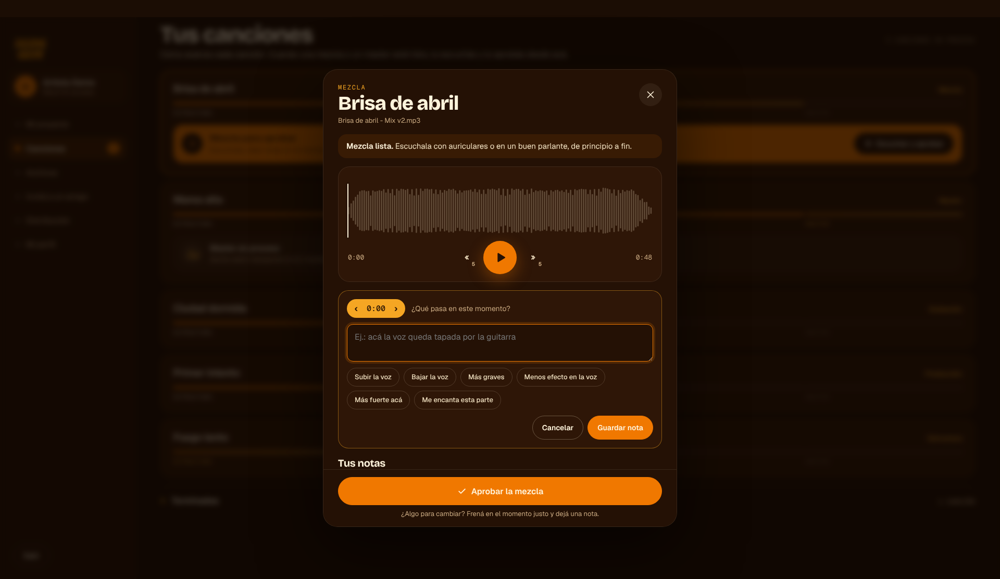

- **media** · Texto cortado · `label.sr-only «Tu nota»` — Muestra 1×1px de 46×17px.
- **media** · Tapado por otro elemento · `a.nav-mark` — Lo tapa div.rv-backdrop.
- **media** · Tapado por otro elemento · `button.tab «Mi proyecto»` — Lo tapa div.rv-backdrop.
- **media** · Tapado por otro elemento · `button.tab.is-active «Canciones 1»` — Lo tapa div.rv-backdrop.
- **media** · Tapado por otro elemento · `button.tab «Archivos»` — Lo tapa div.rv-backdrop.
- **media** · Tapado por otro elemento · `button.tab «Invitá a un amigo»` — Lo tapa div.rv-backdrop.
- **media** · Tapado por otro elemento · `button.tab «Distribución»` — Lo tapa div.rv-backdrop.
- **media** · Tapado por otro elemento · `button.tab «Mi perfil»` — Lo tapa div.rv-backdrop.
- **media** · Tapado por otro elemento · `button#logoutBtn.btn «Salir»` — Lo tapa div.rv-backdrop.
- **media** · Tapado por otro elemento · `button.btn.dv-play «Escuchar y aprobar»` — Lo tapa div.rv-backdrop.
- **media** · Tapado por otro elemento · `summary «Terminadas 1 CANCIÓN»` — Lo tapa button.btn.btn-primary «Aprobar la mezcla».
- **media** · Tapado por otro elemento · `label.sr-only «Tu nota»` — Lo tapa div.rv-compose-top «‹ 0:00 › ¿Qué pasa en este momento?».
- **baja** · Texto muy chico · `small «5»` — Letra de 10px. (×2)

### Archivos (tu espacio) — sin problemas

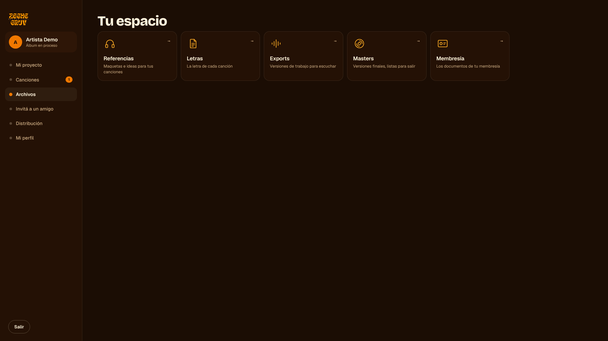

### Letras (cuaderno) — sin problemas

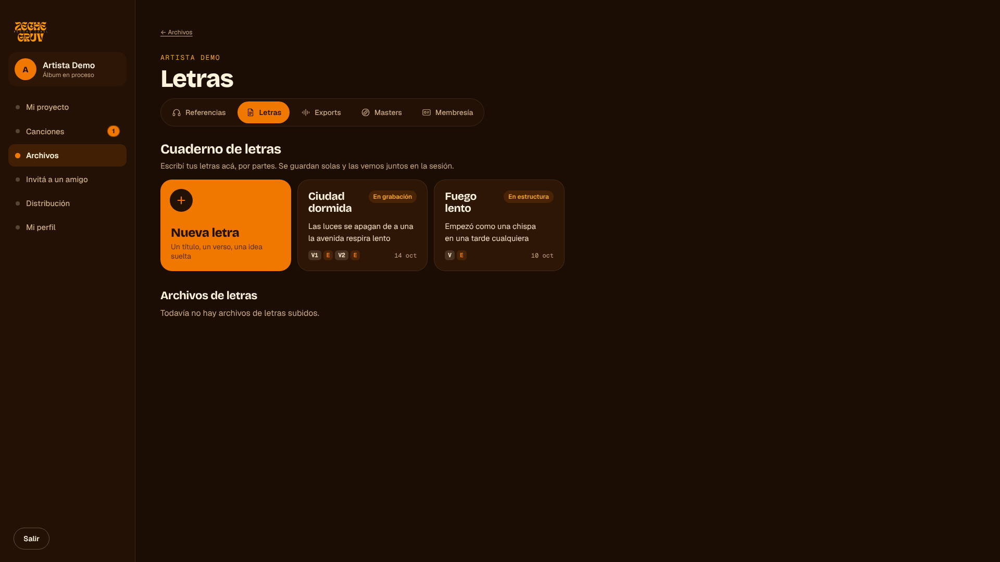

### Editor de una letra — sin problemas

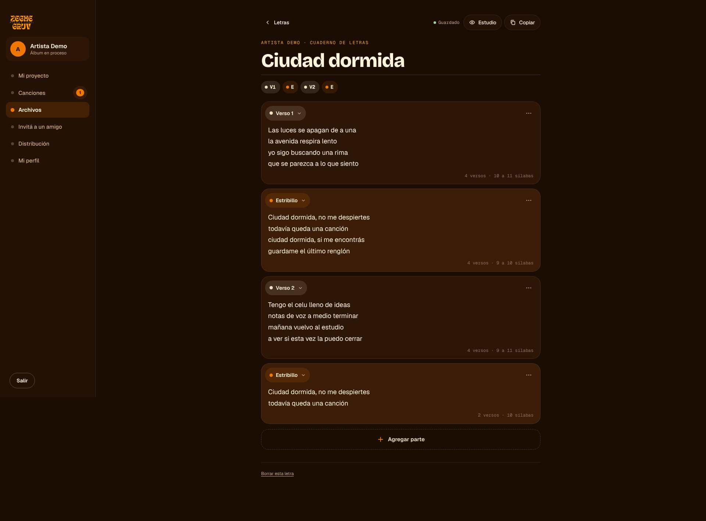

### Exports (archivos abiertos) — sin problemas

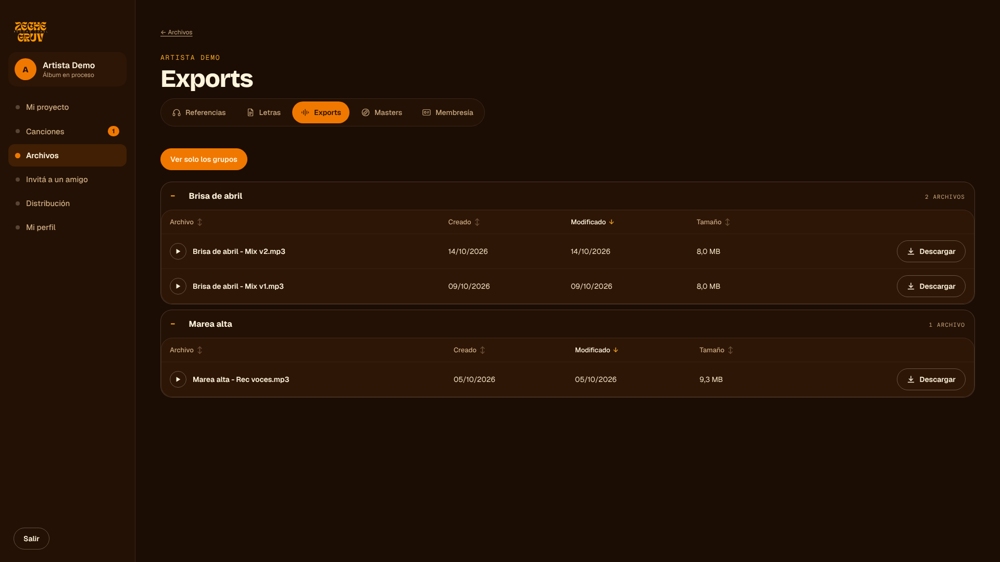

### Masters — sin problemas

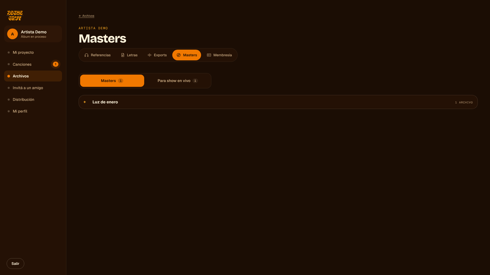

### Distribución (lanzamientos) — sin problemas

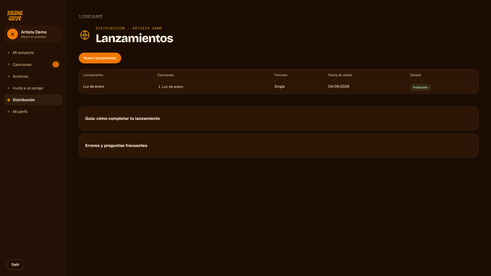

### Nuevo lanzamiento (formulario) — sin problemas

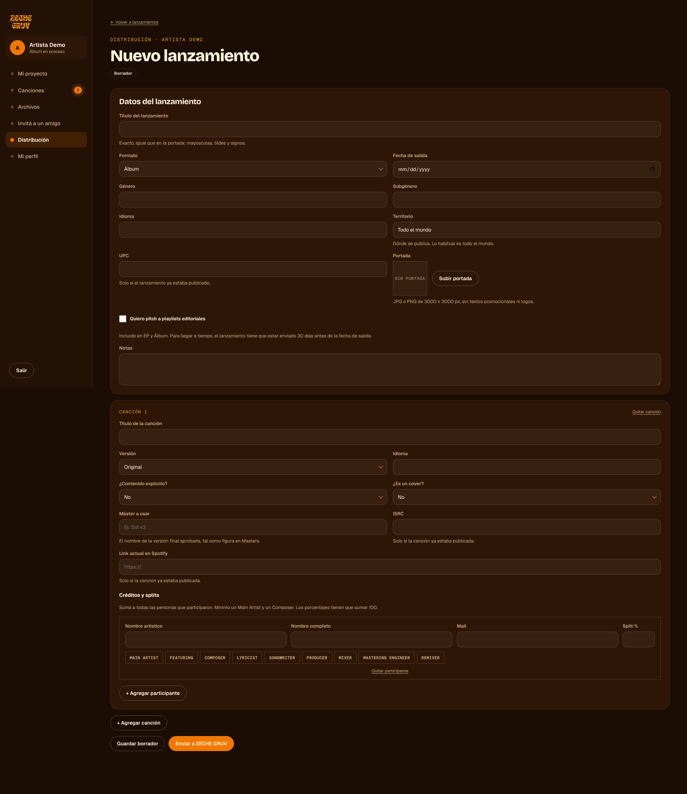

### Invitá a un amigo — sin problemas

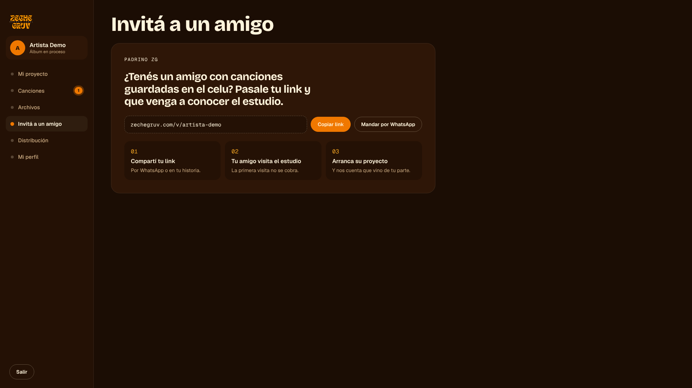

### Mi perfil — sin problemas

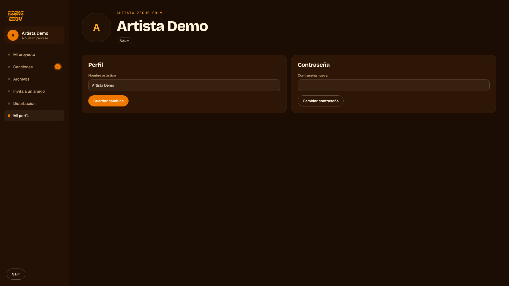

## Tablet 820 × 1180

### Ingreso (login) — 5 hallazgos

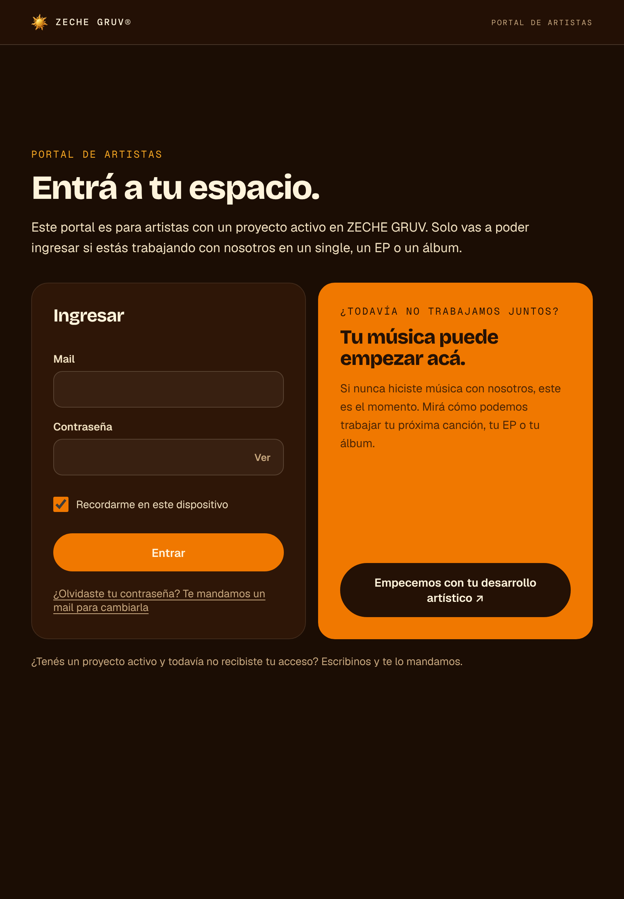

- **media** · Difícil de tocar con el dedo · `label «Mail»` — 303×18px (se recomienda 44×44).
- **media** · Difícil de tocar con el dedo · `label «Contraseña»` — 303×18px (se recomienda 44×44).
- **media** · Difícil de tocar con el dedo · `input#rememberMe` — 20×20px (se recomienda 44×44).
- **baja** · Texto muy chico · `span.nav-tag «PORTAL DE ARTISTAS»` — Letra de 10px.
- **baja** · Difícil de tocar con el dedo · `a.nav-mark «ZECHE GRUV®»` — 132×36px (se recomienda 44×44).

### Mi proyecto — 9 hallazgos

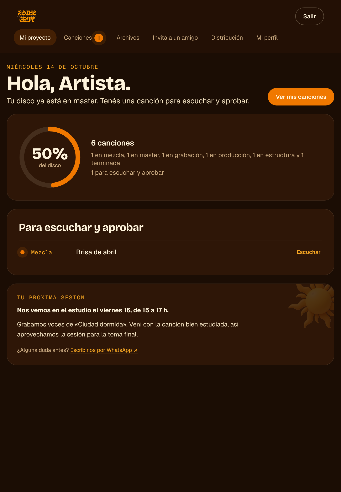

- **baja** · Difícil de tocar con el dedo · `button.tab.is-active «Mi proyecto»` — 103×40px (se recomienda 44×44).
- **baja** · Difícil de tocar con el dedo · `button.tab «Canciones1»` — 122×40px (se recomienda 44×44).
- **baja** · Difícil de tocar con el dedo · `button.tab «Archivos»` — 83×40px (se recomienda 44×44).
- **baja** · Difícil de tocar con el dedo · `button.tab «Invitá a un amigo»` — 137×40px (se recomienda 44×44).
- **baja** · Difícil de tocar con el dedo · `button.tab «Distribución»` — 105×40px (se recomienda 44×44).
- **baja** · Difícil de tocar con el dedo · `button.tab «Mi perfil»` — 79×40px (se recomienda 44×44).
- **baja** · Difícil de tocar con el dedo · `button#logoutBtn.btn «Salir»` — 69×42px (se recomienda 44×44).
- **baja** · Difícil de tocar con el dedo · `button.btn.btn-primary «Ver mis canciones»` — 160×42px (se recomienda 44×44).
- **baja** · Difícil de tocar con el dedo · `a «Escribinos por WhatsApp ↗»` — 162×18px (se recomienda 44×44).

### Canciones — 16 hallazgos

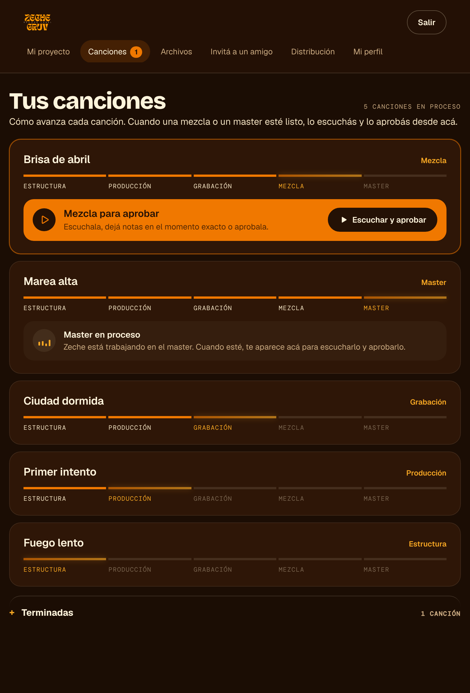

- **baja** · Texto muy chico · `span#songsCount.songs-count «5 CANCIONES EN PROCESO»` — Letra de 11px.
- **baja** · Texto muy chico · `span «ESTRUCTURA»` — Letra de 11px. (×5)
- **baja** · Texto muy chico · `span «PRODUCCIÓN»` — Letra de 11px. (×5)
- **baja** · Texto muy chico · `span «GRABACIÓN»` — Letra de 11px. (×5)
- **baja** · Texto muy chico · `span «MEZCLA»` — Letra de 11px. (×5)
- **baja** · Texto muy chico · `span «MASTER»` — Letra de 11px. (×5)
- **baja** · Texto muy chico · `span#songsDoneCount.songs-count «1 CANCIÓN»` — Letra de 11px.
- **baja** · Difícil de tocar con el dedo · `button.tab «Mi proyecto»` — 103×40px (se recomienda 44×44).
- **baja** · Difícil de tocar con el dedo · `button.tab.is-active «Canciones1»` — 122×40px (se recomienda 44×44).
- **baja** · Difícil de tocar con el dedo · `button.tab «Archivos»` — 83×40px (se recomienda 44×44).
- **baja** · Difícil de tocar con el dedo · `button.tab «Invitá a un amigo»` — 137×40px (se recomienda 44×44).
- **baja** · Difícil de tocar con el dedo · `button.tab «Distribución»` — 105×40px (se recomienda 44×44).
- **baja** · Difícil de tocar con el dedo · `button.tab «Mi perfil»` — 79×40px (se recomienda 44×44).
- **baja** · Difícil de tocar con el dedo · `button#logoutBtn.btn «Salir»` — 69×42px (se recomienda 44×44).
- **baja** · Difícil de tocar con el dedo · `button.btn.dv-play «Escuchar y aprobar»` — 191×42px (se recomienda 44×44).
- **baja** · Difícil de tocar con el dedo · `summary «Terminadas 1 CANCIÓN»` — 788×43px (se recomienda 44×44).

### Escuchar y aprobar (reproductor) — 27 hallazgos

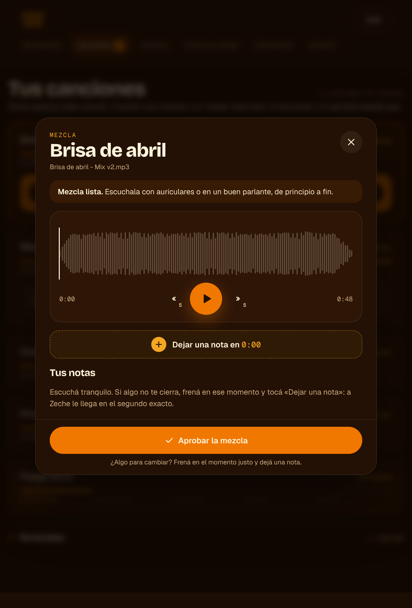

- **media** · Tapado por otro elemento · `a.nav-mark` — Lo tapa div.rv-backdrop.
- **media** · Tapado por otro elemento · `button.tab «Mi proyecto»` — Lo tapa div.rv-backdrop.
- **media** · Tapado por otro elemento · `button.tab.is-active «Canciones1»` — Lo tapa div.rv-backdrop.
- **media** · Tapado por otro elemento · `button.tab «Archivos»` — Lo tapa div.rv-backdrop.
- **media** · Tapado por otro elemento · `button.tab «Invitá a un amigo»` — Lo tapa div.rv-backdrop.
- **media** · Tapado por otro elemento · `button.tab «Distribución»` — Lo tapa div.rv-backdrop.
- **media** · Tapado por otro elemento · `button.tab «Mi perfil»` — Lo tapa div.rv-backdrop.
- **media** · Tapado por otro elemento · `button#logoutBtn.btn «Salir»` — Lo tapa div.rv-backdrop.
- **media** · Tapado por otro elemento · `button.btn.dv-play «Escuchar y aprobar»` — Lo tapa div#rvBanner.rv-banner «Mezcla lista. Escuchala con auriculares o en un bu».
- **media** · Tapado por otro elemento · `summary «Terminadas 1 CANCIÓN»` — Lo tapa div.rv-backdrop.
- **baja** · Texto muy chico · `span#songsCount.songs-count «5 CANCIONES EN PROCESO»` — Letra de 11px.
- **baja** · Texto muy chico · `span «ESTRUCTURA»` — Letra de 11px. (×5)
- **baja** · Texto muy chico · `span «PRODUCCIÓN»` — Letra de 11px. (×5)
- **baja** · Texto muy chico · `span «GRABACIÓN»` — Letra de 11px. (×5)
- **baja** · Texto muy chico · `span «MEZCLA»` — Letra de 11px. (×5)
- **baja** · Texto muy chico · `span «MASTER»` — Letra de 11px. (×5)
- **baja** · Texto muy chico · `span#songsDoneCount.songs-count «1 CANCIÓN»` — Letra de 11px.
- **baja** · Texto muy chico · `small «5»` — Letra de 10px. (×2)
- **baja** · Difícil de tocar con el dedo · `button.tab «Mi proyecto»` — 103×40px (se recomienda 44×44).
- **baja** · Difícil de tocar con el dedo · `button.tab.is-active «Canciones1»` — 122×40px (se recomienda 44×44).
- **baja** · Difícil de tocar con el dedo · `button.tab «Archivos»` — 83×40px (se recomienda 44×44).
- **baja** · Difícil de tocar con el dedo · `button.tab «Invitá a un amigo»` — 137×40px (se recomienda 44×44).
- **baja** · Difícil de tocar con el dedo · `button.tab «Distribución»` — 105×40px (se recomienda 44×44).
- **baja** · Difícil de tocar con el dedo · `button.tab «Mi perfil»` — 79×40px (se recomienda 44×44).
- **baja** · Difícil de tocar con el dedo · `button#logoutBtn.btn «Salir»` — 69×42px (se recomienda 44×44).
- **baja** · Difícil de tocar con el dedo · `button.btn.dv-play «Escuchar y aprobar»` — 191×42px (se recomienda 44×44).
- **baja** · Difícil de tocar con el dedo · `summary «Terminadas 1 CANCIÓN»` — 788×43px (se recomienda 44×44).

### Dejar una nota (formulario) — 38 hallazgos

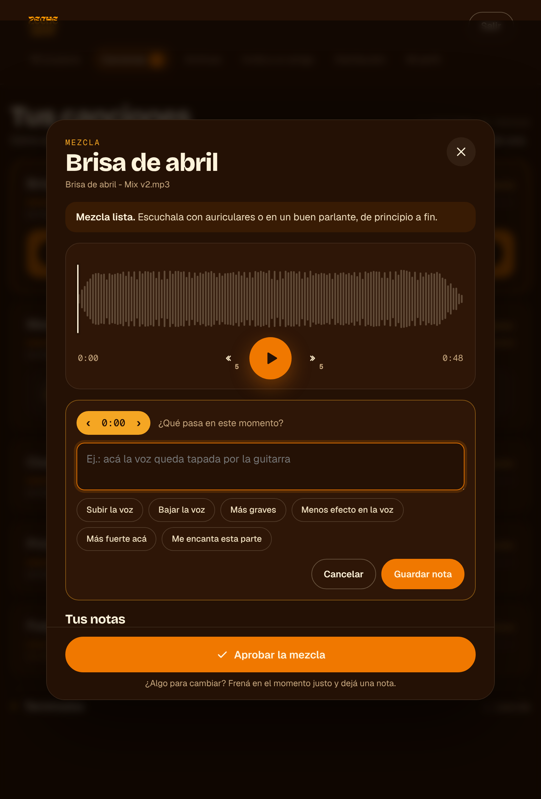

- **media** · Texto cortado · `label.sr-only «Tu nota»` — Muestra 1×1px de 46×17px.
- **media** · Tapado por otro elemento · `a.nav-mark` — Lo tapa div.rv-backdrop.
- **media** · Tapado por otro elemento · `button.tab «Mi proyecto»` — Lo tapa div.rv-backdrop.
- **media** · Tapado por otro elemento · `button.tab.is-active «Canciones1»` — Lo tapa div.rv-backdrop.
- **media** · Tapado por otro elemento · `button.tab «Archivos»` — Lo tapa div.rv-backdrop.
- **media** · Tapado por otro elemento · `button.tab «Invitá a un amigo»` — Lo tapa div.rv-backdrop.
- **media** · Tapado por otro elemento · `button.tab «Distribución»` — Lo tapa div.rv-backdrop.
- **media** · Tapado por otro elemento · `button.tab «Mi perfil»` — Lo tapa div.rv-backdrop.
- **media** · Tapado por otro elemento · `button#logoutBtn.btn «Salir»` — Lo tapa div.rv-backdrop.
- **media** · Tapado por otro elemento · `button.btn.dv-play «Escuchar y aprobar»` — Lo tapa div.rv-player «0:00 5 5 0:48».
- **media** · Tapado por otro elemento · `summary «Terminadas 1 CANCIÓN»` — Lo tapa div.rv-backdrop.
- **media** · Difícil de tocar con el dedo · `label.sr-only «Tu nota»` — 1×1px (se recomienda 44×44).
- **media** · Tapado por otro elemento · `label.sr-only «Tu nota»` — Lo tapa div.rv-compose-top «‹ 0:00 › ¿Qué pasa en este momento?».
- **baja** · Texto muy chico · `span#songsCount.songs-count «5 CANCIONES EN PROCESO»` — Letra de 11px.
- **baja** · Texto muy chico · `span «ESTRUCTURA»` — Letra de 11px. (×5)
- **baja** · Texto muy chico · `span «PRODUCCIÓN»` — Letra de 11px. (×5)
- **baja** · Texto muy chico · `span «GRABACIÓN»` — Letra de 11px. (×5)
- **baja** · Texto muy chico · `span «MEZCLA»` — Letra de 11px. (×5)
- **baja** · Texto muy chico · `span «MASTER»` — Letra de 11px. (×5)
- **baja** · Texto muy chico · `span#songsDoneCount.songs-count «1 CANCIÓN»` — Letra de 11px.
- **baja** · Texto muy chico · `small «5»` — Letra de 10px. (×2)
- **baja** · Difícil de tocar con el dedo · `button.tab «Mi proyecto»` — 103×40px (se recomienda 44×44).
- **baja** · Difícil de tocar con el dedo · `button.tab.is-active «Canciones1»` — 122×40px (se recomienda 44×44).
- **baja** · Difícil de tocar con el dedo · `button.tab «Archivos»` — 83×40px (se recomienda 44×44).
- **baja** · Difícil de tocar con el dedo · `button.tab «Invitá a un amigo»` — 137×40px (se recomienda 44×44).
- **baja** · Difícil de tocar con el dedo · `button.tab «Distribución»` — 105×40px (se recomienda 44×44).
- **baja** · Difícil de tocar con el dedo · `button.tab «Mi perfil»` — 79×40px (se recomienda 44×44).
- **baja** · Difícil de tocar con el dedo · `button#logoutBtn.btn «Salir»` — 69×42px (se recomienda 44×44).
- **baja** · Difícil de tocar con el dedo · `button.btn.dv-play «Escuchar y aprobar»` — 191×42px (se recomienda 44×44).
- **baja** · Difícil de tocar con el dedo · `summary «Terminadas 1 CANCIÓN»` — 788×43px (se recomienda 44×44).
- **baja** · Difícil de tocar con el dedo · `button «‹»` — 36×36px (se recomienda 44×44).
- **baja** · Difícil de tocar con el dedo · `button «›»` — 36×36px (se recomienda 44×44).
- **baja** · Difícil de tocar con el dedo · `button «Subir la voz»` — 101×36px (se recomienda 44×44).
- **baja** · Difícil de tocar con el dedo · `button «Bajar la voz»` — 101×36px (se recomienda 44×44).
- **baja** · Difícil de tocar con el dedo · `button «Más graves»` — 100×36px (se recomienda 44×44).
- **baja** · Difícil de tocar con el dedo · `button «Menos efecto en la voz»` — 170×36px (se recomienda 44×44).
- **baja** · Difícil de tocar con el dedo · `button «Más fuerte acá»` — 121×36px (se recomienda 44×44).
- **baja** · Difícil de tocar con el dedo · `button «Me encanta esta parte»` — 167×36px (se recomienda 44×44).

### Archivos (tu espacio) — 7 hallazgos

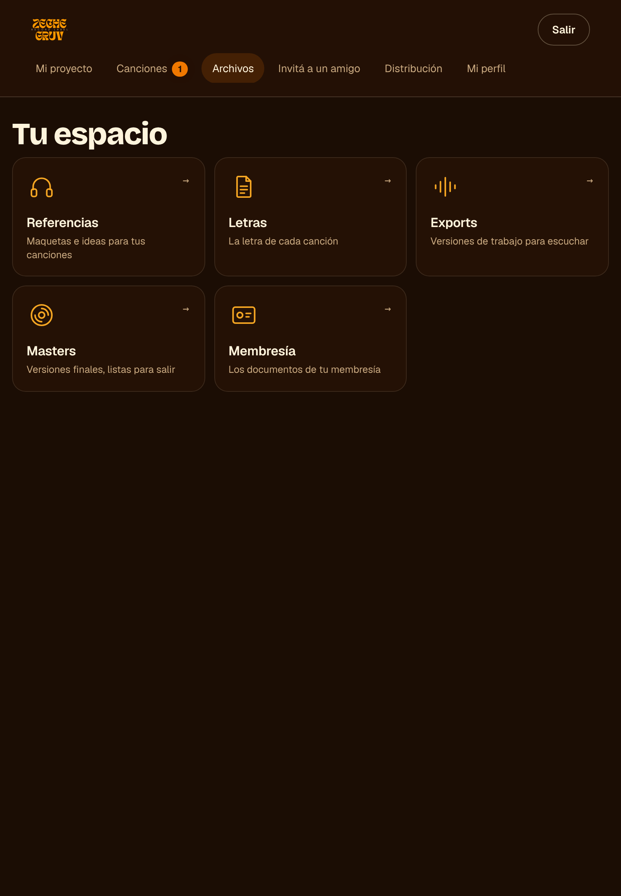

- **baja** · Difícil de tocar con el dedo · `button.tab «Mi proyecto»` — 103×40px (se recomienda 44×44).
- **baja** · Difícil de tocar con el dedo · `button.tab «Canciones1»` — 122×40px (se recomienda 44×44).
- **baja** · Difícil de tocar con el dedo · `button.tab.is-active «Archivos»` — 83×40px (se recomienda 44×44).
- **baja** · Difícil de tocar con el dedo · `button.tab «Invitá a un amigo»` — 137×40px (se recomienda 44×44).
- **baja** · Difícil de tocar con el dedo · `button.tab «Distribución»` — 105×40px (se recomienda 44×44).
- **baja** · Difícil de tocar con el dedo · `button.tab «Mi perfil»` — 79×40px (se recomienda 44×44).
- **baja** · Difícil de tocar con el dedo · `button#logoutBtn.btn «Salir»` — 69×42px (se recomienda 44×44).

### Letras (cuaderno) — 16 hallazgos

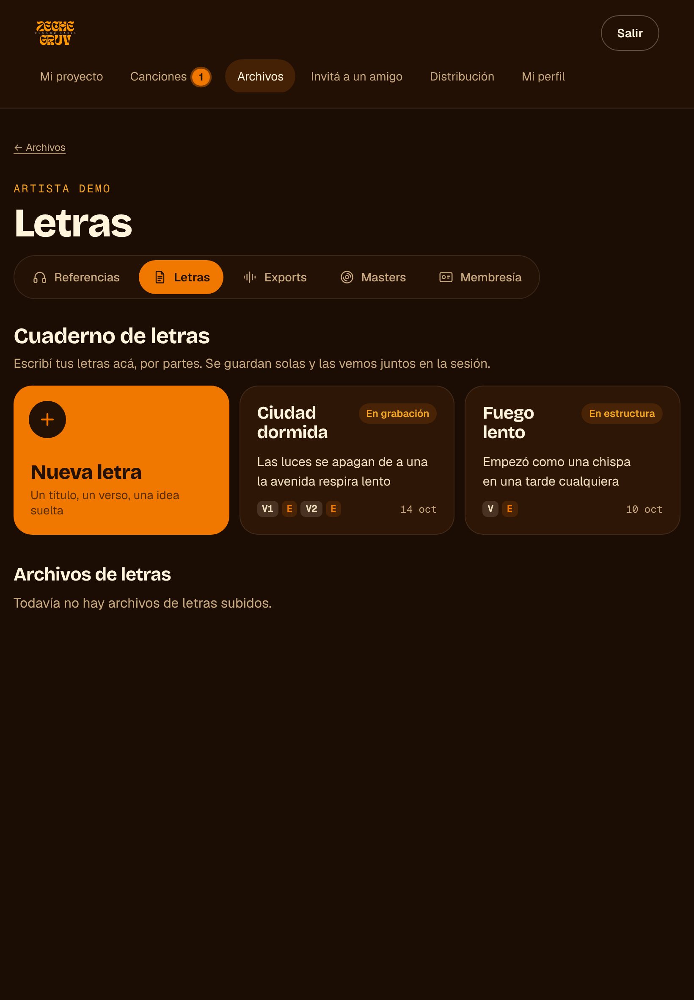

- **baja** · Texto muy chico · `i.k-verso «V1»` — Letra de 11px.
- **baja** · Texto muy chico · `i.k-estribillo «E»` — Letra de 11px. (×3)
- **baja** · Texto muy chico · `i.k-verso «V2»` — Letra de 11px.
- **baja** · Texto muy chico · `i.k-verso «V»` — Letra de 11px.
- **baja** · Difícil de tocar con el dedo · `button.tab «Mi proyecto»` — 103×40px (se recomienda 44×44).
- **baja** · Difícil de tocar con el dedo · `button.tab «Canciones1»` — 122×40px (se recomienda 44×44).
- **baja** · Difícil de tocar con el dedo · `button.tab.is-active «Archivos»` — 83×40px (se recomienda 44×44).
- **baja** · Difícil de tocar con el dedo · `button.tab «Invitá a un amigo»` — 137×40px (se recomienda 44×44).
- **baja** · Difícil de tocar con el dedo · `button.tab «Distribución»` — 105×40px (se recomienda 44×44).
- **baja** · Difícil de tocar con el dedo · `button.tab «Mi perfil»` — 79×40px (se recomienda 44×44).
- **baja** · Difícil de tocar con el dedo · `button#logoutBtn.btn «Salir»` — 69×42px (se recomienda 44×44).
- **baja** · Difícil de tocar con el dedo · `button «Referencias»` — 136×40px (se recomienda 44×44).
- **baja** · Difícil de tocar con el dedo · `button.is-active «Letras»` — 101×40px (se recomienda 44×44).
- **baja** · Difícil de tocar con el dedo · `button «Exports»` — 108×40px (se recomienda 44×44).
- **baja** · Difícil de tocar con el dedo · `button «Masters»` — 111×40px (se recomienda 44×44).
- **baja** · Difícil de tocar con el dedo · `button «Membresía»` — 131×40px (se recomienda 44×44).

### Editor de una letra — 19 hallazgos

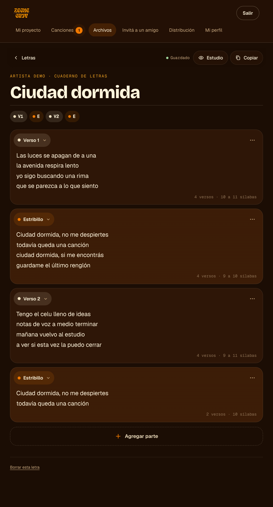

- **baja** · Difícil de tocar con el dedo · `button.tab «Mi proyecto»` — 103×40px (se recomienda 44×44).
- **baja** · Difícil de tocar con el dedo · `button.tab «Canciones1»` — 122×40px (se recomienda 44×44).
- **baja** · Difícil de tocar con el dedo · `button.tab.is-active «Archivos»` — 83×40px (se recomienda 44×44).
- **baja** · Difícil de tocar con el dedo · `button.tab «Invitá a un amigo»` — 137×40px (se recomienda 44×44).
- **baja** · Difícil de tocar con el dedo · `button.tab «Distribución»` — 105×40px (se recomienda 44×44).
- **baja** · Difícil de tocar con el dedo · `button.tab «Mi perfil»` — 79×40px (se recomienda 44×44).
- **baja** · Difícil de tocar con el dedo · `button#logoutBtn.btn «Salir»` — 69×42px (se recomienda 44×44).
- **baja** · Difícil de tocar con el dedo · `button#lyricBack.le-btn.le-back «Letras»` — 91×42px (se recomienda 44×44).
- **baja** · Difícil de tocar con el dedo · `button#lyricRead.le-btn «Estudio»` — 105×42px (se recomienda 44×44).
- **baja** · Difícil de tocar con el dedo · `button#lyricCopy.le-btn «Copiar»` — 99×42px (se recomienda 44×44).
- **baja** · Difícil de tocar con el dedo · `a.le-map-chip.k-verso «V1»` — 52×34px (se recomienda 44×44).
- **baja** · Difícil de tocar con el dedo · `a.le-map-chip.k-estribillo «E»` — 44×34px (se recomienda 44×44). (×2)
- **baja** · Difícil de tocar con el dedo · `a.le-map-chip.k-verso «V2»` — 52×34px (se recomienda 44×44).
- **baja** · Difícil de tocar con el dedo · `button.lp-kind «Verso 1»` — 111×40px (se recomienda 44×44).
- **baja** · Difícil de tocar con el dedo · `button.lp-more «Opciones de Verso 1»` — 42×42px (se recomienda 44×44).
- **baja** · Difícil de tocar con el dedo · `button.lp-kind «Estribillo»` — 122×40px (se recomienda 44×44). (×2)
- **baja** · Difícil de tocar con el dedo · `button.lp-more «Opciones de Estribillo»` — 42×42px (se recomienda 44×44). (×2)
- **baja** · Difícil de tocar con el dedo · `button.lp-kind «Verso 2»` — 114×40px (se recomienda 44×44).
- **baja** · Difícil de tocar con el dedo · `button.lp-more «Opciones de Verso 2»` — 42×42px (se recomienda 44×44).

### Exports (archivos abiertos) — 23 hallazgos

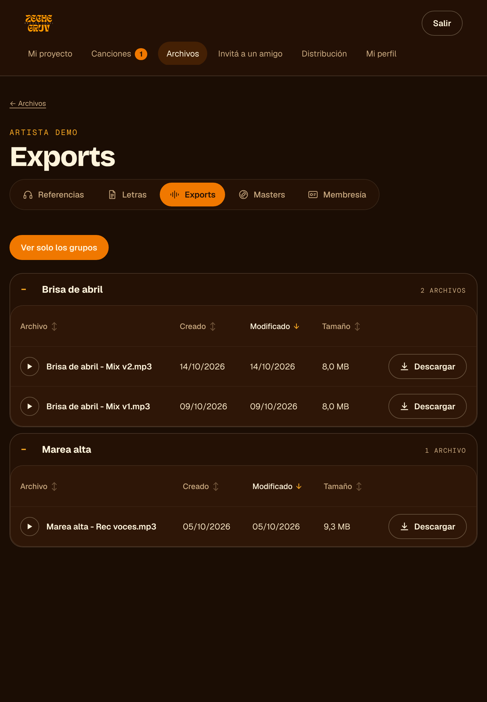

- **baja** · Texto muy chico · `span.group-count «2 ARCHIVOS»` — Letra de 11px.
- **baja** · Texto muy chico · `span.group-count «1 ARCHIVO»` — Letra de 11px.
- **baja** · Difícil de tocar con el dedo · `button.tab «Mi proyecto»` — 103×40px (se recomienda 44×44).
- **baja** · Difícil de tocar con el dedo · `button.tab «Canciones1»` — 122×40px (se recomienda 44×44).
- **baja** · Difícil de tocar con el dedo · `button.tab.is-active «Archivos»` — 83×40px (se recomienda 44×44).
- **baja** · Difícil de tocar con el dedo · `button.tab «Invitá a un amigo»` — 137×40px (se recomienda 44×44).
- **baja** · Difícil de tocar con el dedo · `button.tab «Distribución»` — 105×40px (se recomienda 44×44).
- **baja** · Difícil de tocar con el dedo · `button.tab «Mi perfil»` — 79×40px (se recomienda 44×44).
- **baja** · Difícil de tocar con el dedo · `button#logoutBtn.btn «Salir»` — 69×42px (se recomienda 44×44).
- **baja** · Difícil de tocar con el dedo · `button «Referencias»` — 136×40px (se recomienda 44×44).
- **baja** · Difícil de tocar con el dedo · `button «Letras»` — 99×40px (se recomienda 44×44).
- **baja** · Difícil de tocar con el dedo · `button.is-active «Exports»` — 110×40px (se recomienda 44×44).
- **baja** · Difícil de tocar con el dedo · `button «Masters»` — 111×40px (se recomienda 44×44).
- **baja** · Difícil de tocar con el dedo · `button «Membresía»` — 131×40px (se recomienda 44×44).
- **baja** · Difícil de tocar con el dedo · `button#filesToggleAll.btn «Ver solo los grupos»` — 167×42px (se recomienda 44×44).
- **baja** · Difícil de tocar con el dedo · `button.sort-btn «Archivo ↕»` — 63×40px (se recomienda 44×44). (×2)
- **baja** · Difícil de tocar con el dedo · `button.sort-btn «Creado ↕»` — 61×40px (se recomienda 44×44). (×2)
- **baja** · Difícil de tocar con el dedo · `button.sort-btn.is-active «Modificado ↓»` — 83×40px (se recomienda 44×44). (×2)
- **baja** · Difícil de tocar con el dedo · `button.sort-btn «Tamaño ↕»` — 65×40px (se recomienda 44×44). (×2)
- **baja** · Difícil de tocar con el dedo · `button.play-btn «Escuchar Brisa de abril - Mix v2.mp3»` — 32×32px (se recomienda 44×44).
- **baja** · Difícil de tocar con el dedo · `a.btn.download-btn «Descargar»` — 132×42px (se recomienda 44×44). (×3)
- **baja** · Difícil de tocar con el dedo · `button.play-btn «Escuchar Brisa de abril - Mix v1.mp3»` — 32×32px (se recomienda 44×44).
- **baja** · Difícil de tocar con el dedo · `button.play-btn «Escuchar Marea alta - Rec voces.mp3»` — 32×32px (se recomienda 44×44).

### Masters — 17 hallazgos

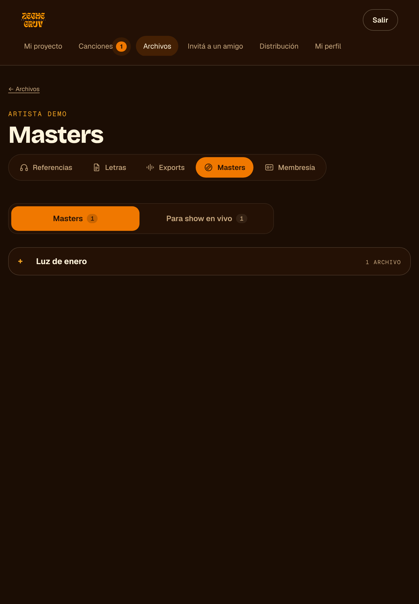

- **baja** · Texto muy chico · `span.group-count «1 ARCHIVO»` — Letra de 11px.
- **baja** · Difícil de tocar con el dedo · `button.tab «Mi proyecto»` — 103×40px (se recomienda 44×44).
- **baja** · Difícil de tocar con el dedo · `button.tab «Canciones1»` — 122×40px (se recomienda 44×44).
- **baja** · Difícil de tocar con el dedo · `button.tab.is-active «Archivos»` — 83×40px (se recomienda 44×44).
- **baja** · Difícil de tocar con el dedo · `button.tab «Invitá a un amigo»` — 137×40px (se recomienda 44×44).
- **baja** · Difícil de tocar con el dedo · `button.tab «Distribución»` — 105×40px (se recomienda 44×44).
- **baja** · Difícil de tocar con el dedo · `button.tab «Mi perfil»` — 79×40px (se recomienda 44×44).
- **baja** · Difícil de tocar con el dedo · `button#logoutBtn.btn «Salir»` — 69×42px (se recomienda 44×44).
- **baja** · Difícil de tocar con el dedo · `button «Referencias»` — 136×40px (se recomienda 44×44).
- **baja** · Difícil de tocar con el dedo · `button «Letras»` — 99×40px (se recomienda 44×44).
- **baja** · Difícil de tocar con el dedo · `button «Exports»` — 108×40px (se recomienda 44×44).
- **baja** · Difícil de tocar con el dedo · `button.is-active «Masters»` — 113×40px (se recomienda 44×44).
- **baja** · Difícil de tocar con el dedo · `button «Membresía»` — 131×40px (se recomienda 44×44).
- **baja** · Difícil de tocar con el dedo · `button.sort-btn` — 63×40px (se recomienda 44×44). (×3)
- **baja** · Difícil de tocar con el dedo · `button.sort-btn.is-active` — 83×40px (se recomienda 44×44).
- **baja** · Difícil de tocar con el dedo · `button.play-btn «Escuchar Luz de enero - Master.wav»` — 32×32px (se recomienda 44×44).
- **baja** · Difícil de tocar con el dedo · `a.btn.download-btn «Descargar Luz de enero - Master.wav»` — 132×42px (se recomienda 44×44).

### Distribución (lanzamientos) — 8 hallazgos

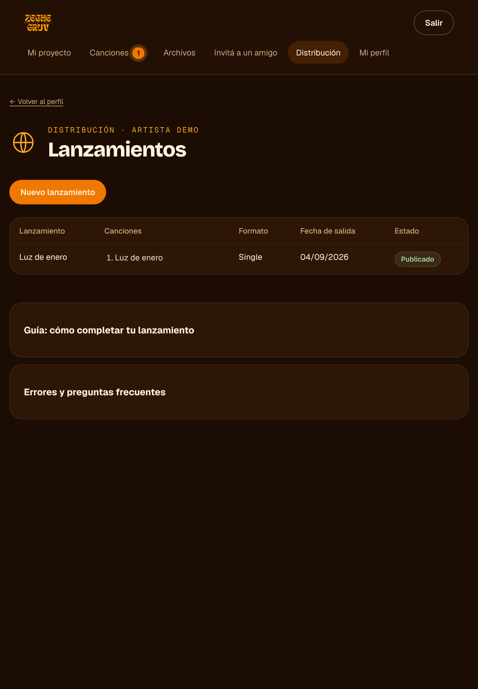

- **baja** · Difícil de tocar con el dedo · `button.tab «Mi proyecto»` — 103×40px (se recomienda 44×44).
- **baja** · Difícil de tocar con el dedo · `button.tab «Canciones1»` — 122×40px (se recomienda 44×44).
- **baja** · Difícil de tocar con el dedo · `button.tab «Archivos»` — 83×40px (se recomienda 44×44).
- **baja** · Difícil de tocar con el dedo · `button.tab «Invitá a un amigo»` — 137×40px (se recomienda 44×44).
- **baja** · Difícil de tocar con el dedo · `button.tab.is-active «Distribución»` — 105×40px (se recomienda 44×44).
- **baja** · Difícil de tocar con el dedo · `button.tab «Mi perfil»` — 79×40px (se recomienda 44×44).
- **baja** · Difícil de tocar con el dedo · `button#logoutBtn.btn «Salir»` — 69×42px (se recomienda 44×44).
- **baja** · Difícil de tocar con el dedo · `button#newReleaseBtn.btn.btn-primary «Nuevo lanzamiento»` — 166×42px (se recomienda 44×44).

### Nuevo lanzamiento (formulario) — 29 hallazgos

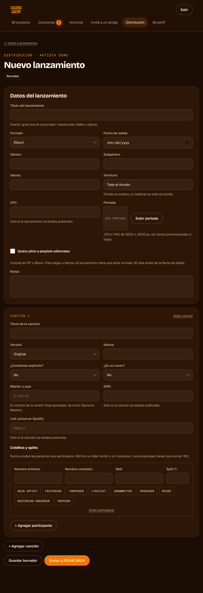

- **media** · Difícil de tocar con el dedo · `label «Título del lanzamiento»` — 738×17px (se recomienda 44×44).
- **media** · Difícil de tocar con el dedo · `label «Formato»` — 361×17px (se recomienda 44×44).
- **media** · Difícil de tocar con el dedo · `label «Fecha de salida»` — 361×17px (se recomienda 44×44).
- **media** · Difícil de tocar con el dedo · `label «Género»` — 361×17px (se recomienda 44×44).
- **media** · Difícil de tocar con el dedo · `label «Subgénero»` — 361×17px (se recomienda 44×44).
- **media** · Difícil de tocar con el dedo · `label «Idioma»` — 361×17px (se recomienda 44×44).
- **media** · Difícil de tocar con el dedo · `label «Territorio»` — 361×17px (se recomienda 44×44).
- **media** · Difícil de tocar con el dedo · `label «UPC»` — 361×17px (se recomienda 44×44).
- **media** · Difícil de tocar con el dedo · `label «Portada»` — 361×17px (se recomienda 44×44).
- **media** · Difícil de tocar con el dedo · `input#rPitch` — 20×20px (se recomienda 44×44).
- **media** · Difícil de tocar con el dedo · `label «Notas»` — 738×17px (se recomienda 44×44).
- **baja** · Texto muy chico · `div#coverEmpty.cover-preview.cover-empty «SIN PORTADA»` — Letra de 11px.
- **baja** · Texto muy chico · `span «MAIN ARTIST»` — Letra de 11px.
- **baja** · Texto muy chico · `span «FEATURING»` — Letra de 11px.
- **baja** · Texto muy chico · `span «COMPOSER»` — Letra de 11px.
- **baja** · Texto muy chico · `span «LYRICIST»` — Letra de 11px.
- **baja** · Texto muy chico · `span «SONGWRITER»` — Letra de 11px.
- **baja** · Texto muy chico · `span «PRODUCER»` — Letra de 11px.
- **baja** · Texto muy chico · `span «MIXER»` — Letra de 11px.
- **baja** · Texto muy chico · `span «MASTERING ENGINEER»` — Letra de 11px.
- **baja** · Texto muy chico · `span «REMIXER»` — Letra de 11px.
- **baja** · Difícil de tocar con el dedo · `button.tab «Mi proyecto»` — 103×40px (se recomienda 44×44).
- **baja** · Difícil de tocar con el dedo · `button.tab «Canciones1»` — 122×40px (se recomienda 44×44).
- **baja** · Difícil de tocar con el dedo · `button.tab «Archivos»` — 83×40px (se recomienda 44×44).
- **baja** · Difícil de tocar con el dedo · `button.tab «Invitá a un amigo»` — 137×40px (se recomienda 44×44).
- **baja** · Difícil de tocar con el dedo · `button.tab.is-active «Distribución»` — 105×40px (se recomienda 44×44).
- **baja** · Difícil de tocar con el dedo · `button.tab «Mi perfil»` — 79×40px (se recomienda 44×44).
- **baja** · Difícil de tocar con el dedo · `button#logoutBtn.btn «Salir»` — 69×42px (se recomienda 44×44).
- **baja** · Difícil de tocar con el dedo · `button#coverBtn.btn «Subir portada»` — 130×42px (se recomienda 44×44).

### Invitá a un amigo — 9 hallazgos

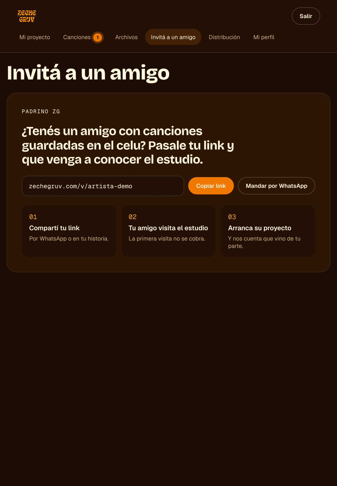

- **baja** · Difícil de tocar con el dedo · `button.tab «Mi proyecto»` — 103×40px (se recomienda 44×44).
- **baja** · Difícil de tocar con el dedo · `button.tab «Canciones1»` — 122×40px (se recomienda 44×44).
- **baja** · Difícil de tocar con el dedo · `button.tab «Archivos»` — 83×40px (se recomienda 44×44).
- **baja** · Difícil de tocar con el dedo · `button.tab.is-active «Invitá a un amigo»` — 137×40px (se recomienda 44×44).
- **baja** · Difícil de tocar con el dedo · `button.tab «Distribución»` — 105×40px (se recomienda 44×44).
- **baja** · Difícil de tocar con el dedo · `button.tab «Mi perfil»` — 79×40px (se recomienda 44×44).
- **baja** · Difícil de tocar con el dedo · `button#logoutBtn.btn «Salir»` — 69×42px (se recomienda 44×44).
- **baja** · Difícil de tocar con el dedo · `button#ivCopy.btn.btn-primary «Copiar link»` — 111×42px (se recomienda 44×44).
- **baja** · Difícil de tocar con el dedo · `a.btn «Mandar por WhatsApp»` — 188×42px (se recomienda 44×44).

### Mi perfil — 12 hallazgos

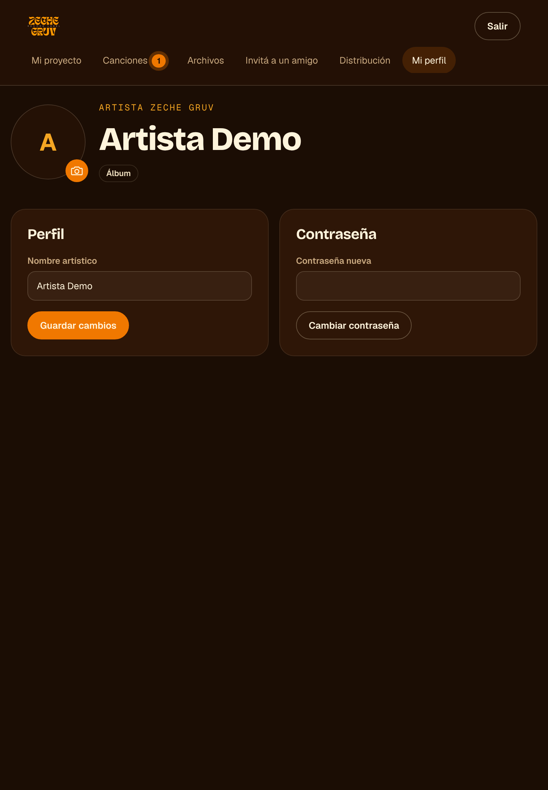

- **media** · Difícil de tocar con el dedo · `label «Nombre artístico»` — 336×17px (se recomienda 44×44).
- **media** · Difícil de tocar con el dedo · `label «Contraseña nueva»` — 336×17px (se recomienda 44×44).
- **baja** · Difícil de tocar con el dedo · `button.tab «Mi proyecto»` — 103×40px (se recomienda 44×44).
- **baja** · Difícil de tocar con el dedo · `button.tab «Canciones1»` — 122×40px (se recomienda 44×44).
- **baja** · Difícil de tocar con el dedo · `button.tab «Archivos»` — 83×40px (se recomienda 44×44).
- **baja** · Difícil de tocar con el dedo · `button.tab «Invitá a un amigo»` — 137×40px (se recomienda 44×44).
- **baja** · Difícil de tocar con el dedo · `button.tab «Distribución»` — 105×40px (se recomienda 44×44).
- **baja** · Difícil de tocar con el dedo · `button.tab.is-active «Mi perfil»` — 79×40px (se recomienda 44×44).
- **baja** · Difícil de tocar con el dedo · `button#logoutBtn.btn «Salir»` — 69×42px (se recomienda 44×44).
- **baja** · Difícil de tocar con el dedo · `button#photoBtn.avatar-change` — 34×34px (se recomienda 44×44).
- **baja** · Difícil de tocar con el dedo · `button.btn.btn-primary «Guardar cambios»` — 152×42px (se recomienda 44×44).
- **baja** · Difícil de tocar con el dedo · `button.btn «Cambiar contraseña»` — 173×42px (se recomienda 44×44).

## Celular 390 × 844

### Ingreso (login) — 4 hallazgos

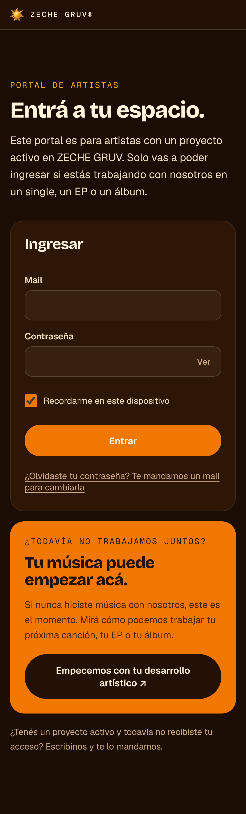

- **media** · Difícil de tocar con el dedo · `label «Mail»` — 312×18px (se recomienda 44×44).
- **media** · Difícil de tocar con el dedo · `label «Contraseña»` — 312×18px (se recomienda 44×44).
- **media** · Difícil de tocar con el dedo · `input#rememberMe` — 20×20px (se recomienda 44×44).
- **baja** · Difícil de tocar con el dedo · `a.nav-mark «ZECHE GRUV®»` — 132×36px (se recomienda 44×44).

### Mi proyecto — 6 hallazgos

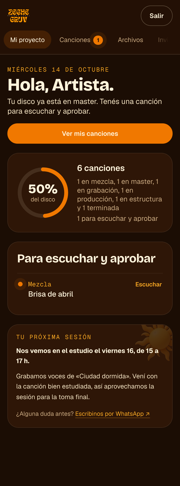

- **baja** · Difícil de tocar con el dedo · `button.tab.is-active «Mi proyecto»` — 103×40px (se recomienda 44×44).
- **baja** · Difícil de tocar con el dedo · `button.tab «Canciones1»` — 122×40px (se recomienda 44×44).
- **baja** · Difícil de tocar con el dedo · `button.tab «Archivos»` — 83×40px (se recomienda 44×44).
- **baja** · Difícil de tocar con el dedo · `button.tab «Invitá a un amigo»` — 137×40px (se recomienda 44×44).
- **baja** · Difícil de tocar con el dedo · `button.tab «Distribución»` — 105×40px (se recomienda 44×44).
- **baja** · Difícil de tocar con el dedo · `button.tab «Mi perfil»` — 79×40px (se recomienda 44×44).

### Canciones — 6 hallazgos

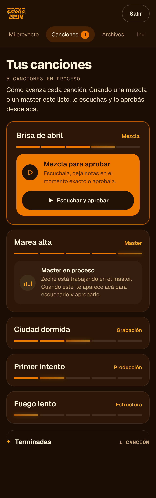

- **baja** · Difícil de tocar con el dedo · `button.tab «Mi proyecto»` — 103×40px (se recomienda 44×44).
- **baja** · Difícil de tocar con el dedo · `button.tab.is-active «Canciones1»` — 122×40px (se recomienda 44×44).
- **baja** · Difícil de tocar con el dedo · `button.tab «Archivos»` — 83×40px (se recomienda 44×44).
- **baja** · Difícil de tocar con el dedo · `button.tab «Invitá a un amigo»` — 137×40px (se recomienda 44×44).
- **baja** · Difícil de tocar con el dedo · `button.tab «Distribución»` — 105×40px (se recomienda 44×44).
- **baja** · Difícil de tocar con el dedo · `button.tab «Mi perfil»` — 79×40px (se recomienda 44×44).

### Escuchar y aprobar (reproductor) — 14 hallazgos

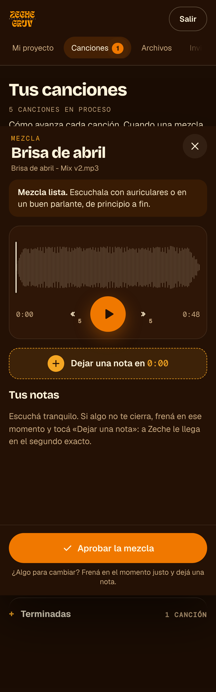

- **media** · Tapado por otro elemento · `button.tab «Mi proyecto»` — Lo tapa header.rv-head «MEZCLA Brisa de abril Brisa de abril - Mix v2.mp3».
- **media** · Tapado por otro elemento · `button.tab.is-active «Canciones1»` — Lo tapa header.rv-head «MEZCLA Brisa de abril Brisa de abril - Mix v2.mp3».
- **media** · Tapado por otro elemento · `button.tab «Archivos»` — Lo tapa header.rv-head «MEZCLA Brisa de abril Brisa de abril - Mix v2.mp3».
- **media** · Tapado por otro elemento · `button.tab «Invitá a un amigo»` — Lo tapa header.rv-head «MEZCLA Brisa de abril Brisa de abril - Mix v2.mp3».
- **media** · Tapado por otro elemento · `button.tab «Distribución»` — Lo tapa header.rv-head «MEZCLA Brisa de abril Brisa de abril - Mix v2.mp3».
- **media** · Tapado por otro elemento · `button.tab «Mi perfil»` — Lo tapa header.rv-head «MEZCLA Brisa de abril Brisa de abril - Mix v2.mp3».
- **media** · Tapado por otro elemento · `button.btn.dv-play «Escuchar y aprobar»` — Lo tapa span «Dejar una nota en 0:00».
- **baja** · Texto muy chico · `small «5»` — Letra de 10px. (×2)
- **baja** · Difícil de tocar con el dedo · `button.tab «Mi proyecto»` — 103×40px (se recomienda 44×44).
- **baja** · Difícil de tocar con el dedo · `button.tab.is-active «Canciones1»` — 122×40px (se recomienda 44×44).
- **baja** · Difícil de tocar con el dedo · `button.tab «Archivos»` — 83×40px (se recomienda 44×44).
- **baja** · Difícil de tocar con el dedo · `button.tab «Invitá a un amigo»` — 137×40px (se recomienda 44×44).
- **baja** · Difícil de tocar con el dedo · `button.tab «Distribución»` — 105×40px (se recomienda 44×44).
- **baja** · Difícil de tocar con el dedo · `button.tab «Mi perfil»` — 79×40px (se recomienda 44×44).

### Dejar una nota (formulario) — 27 hallazgos

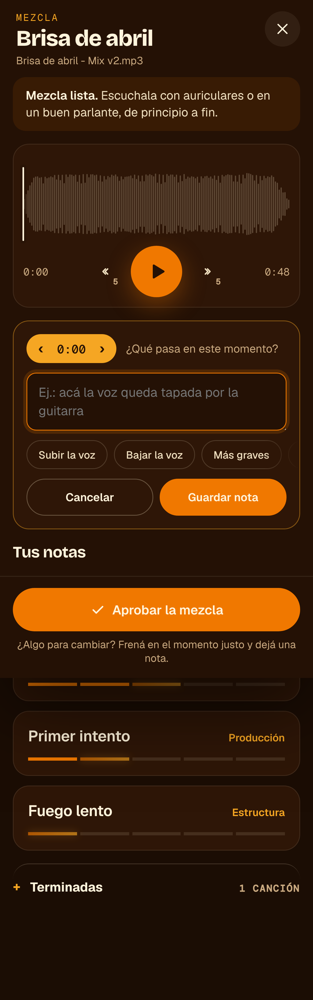

- **media** · Texto cortado · `label.sr-only «Tu nota»` — Muestra 1×1px de 46×17px.
- **media** · Tapado por otro elemento · `a.nav-mark` — Lo tapa h2#rvTitle.rv-title «Brisa de abril».
- **media** · Tapado por otro elemento · `button.tab «Mi proyecto»` — Lo tapa header.rv-head «MEZCLA Brisa de abril Brisa de abril - Mix v2.mp3».
- **media** · Tapado por otro elemento · `button.tab.is-active «Canciones1»` — Lo tapa header.rv-head «MEZCLA Brisa de abril Brisa de abril - Mix v2.mp3».
- **media** · Tapado por otro elemento · `button.tab «Archivos»` — Lo tapa header.rv-head «MEZCLA Brisa de abril Brisa de abril - Mix v2.mp3».
- **media** · Tapado por otro elemento · `button.tab «Invitá a un amigo»` — Lo tapa header.rv-head «MEZCLA Brisa de abril Brisa de abril - Mix v2.mp3».
- **media** · Tapado por otro elemento · `button.tab «Distribución»` — Lo tapa header.rv-head «MEZCLA Brisa de abril Brisa de abril - Mix v2.mp3».
- **media** · Tapado por otro elemento · `button.tab «Mi perfil»` — Lo tapa header.rv-head «MEZCLA Brisa de abril Brisa de abril - Mix v2.mp3».
- **media** · Tapado por otro elemento · `button#logoutBtn.btn «Salir»` — Lo tapa button.rv-icon.rv-x «Cerrar».
- **media** · Tapado por otro elemento · `button.btn.dv-play «Escuchar y aprobar»` — Lo tapa textarea#rvComposeText.
- **media** · Difícil de tocar con el dedo · `label.sr-only «Tu nota»` — 1×1px (se recomienda 44×44).
- **media** · Tapado por otro elemento · `label.sr-only «Tu nota»` — Lo tapa div.rv-compose-top «‹ 0:00 › ¿Qué pasa en este momento?».
- **baja** · Texto muy chico · `small «5»` — Letra de 10px. (×2)
- **baja** · Difícil de tocar con el dedo · `button.tab «Mi proyecto»` — 103×40px (se recomienda 44×44).
- **baja** · Difícil de tocar con el dedo · `button.tab.is-active «Canciones1»` — 122×40px (se recomienda 44×44).
- **baja** · Difícil de tocar con el dedo · `button.tab «Archivos»` — 83×40px (se recomienda 44×44).
- **baja** · Difícil de tocar con el dedo · `button.tab «Invitá a un amigo»` — 137×40px (se recomienda 44×44).
- **baja** · Difícil de tocar con el dedo · `button.tab «Distribución»` — 105×40px (se recomienda 44×44).
- **baja** · Difícil de tocar con el dedo · `button.tab «Mi perfil»` — 79×40px (se recomienda 44×44).
- **baja** · Difícil de tocar con el dedo · `button «‹»` — 36×36px (se recomienda 44×44).
- **baja** · Difícil de tocar con el dedo · `button «›»` — 36×36px (se recomienda 44×44).
- **baja** · Difícil de tocar con el dedo · `button «Subir la voz»` — 101×36px (se recomienda 44×44).
- **baja** · Difícil de tocar con el dedo · `button «Bajar la voz»` — 101×36px (se recomienda 44×44).
- **baja** · Difícil de tocar con el dedo · `button «Más graves»` — 100×36px (se recomienda 44×44).
- **baja** · Difícil de tocar con el dedo · `button «Menos efecto en la voz»` — 170×36px (se recomienda 44×44).
- **baja** · Difícil de tocar con el dedo · `button «Más fuerte acá»` — 121×36px (se recomienda 44×44).
- **baja** · Difícil de tocar con el dedo · `button «Me encanta esta parte»` — 167×36px (se recomienda 44×44).

### Archivos (tu espacio) — 6 hallazgos

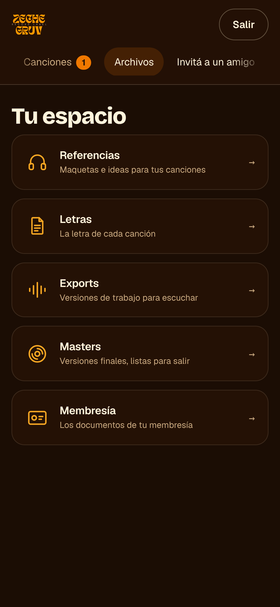

- **baja** · Difícil de tocar con el dedo · `button.tab «Mi proyecto»` — 103×40px (se recomienda 44×44).
- **baja** · Difícil de tocar con el dedo · `button.tab «Canciones1»` — 122×40px (se recomienda 44×44).
- **baja** · Difícil de tocar con el dedo · `button.tab.is-active «Archivos»` — 83×40px (se recomienda 44×44).
- **baja** · Difícil de tocar con el dedo · `button.tab «Invitá a un amigo»` — 137×40px (se recomienda 44×44).
- **baja** · Difícil de tocar con el dedo · `button.tab «Distribución»` — 105×40px (se recomienda 44×44).
- **baja** · Difícil de tocar con el dedo · `button.tab «Mi perfil»` — 79×40px (se recomienda 44×44).

### Letras (cuaderno) — 16 hallazgos

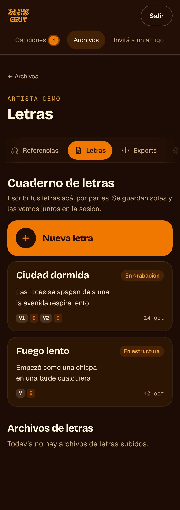

- **media** · Tapado por otro elemento · `button «Membresía»` — Lo tapa use.
- **baja** · Texto muy chico · `i.k-verso «V1»` — Letra de 11px.
- **baja** · Texto muy chico · `i.k-estribillo «E»` — Letra de 11px. (×3)
- **baja** · Texto muy chico · `i.k-verso «V2»` — Letra de 11px.
- **baja** · Texto muy chico · `i.k-verso «V»` — Letra de 11px.
- **baja** · Difícil de tocar con el dedo · `button.tab «Mi proyecto»` — 103×40px (se recomienda 44×44).
- **baja** · Difícil de tocar con el dedo · `button.tab «Canciones1»` — 122×40px (se recomienda 44×44).
- **baja** · Difícil de tocar con el dedo · `button.tab.is-active «Archivos»` — 83×40px (se recomienda 44×44).
- **baja** · Difícil de tocar con el dedo · `button.tab «Invitá a un amigo»` — 137×40px (se recomienda 44×44).
- **baja** · Difícil de tocar con el dedo · `button.tab «Distribución»` — 105×40px (se recomienda 44×44).
- **baja** · Difícil de tocar con el dedo · `button.tab «Mi perfil»` — 79×40px (se recomienda 44×44).
- **baja** · Difícil de tocar con el dedo · `button «Referencias»` — 132×40px (se recomienda 44×44).
- **baja** · Difícil de tocar con el dedo · `button.is-active «Letras»` — 97×40px (se recomienda 44×44).
- **baja** · Difícil de tocar con el dedo · `button «Exports»` — 104×40px (se recomienda 44×44).
- **baja** · Difícil de tocar con el dedo · `button «Masters»` — 107×40px (se recomienda 44×44).
- **baja** · Difícil de tocar con el dedo · `button «Membresía»` — 127×40px (se recomienda 44×44).

### Editor de una letra — 18 hallazgos

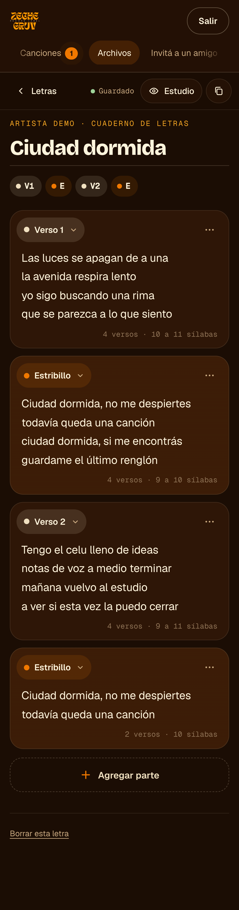

- **baja** · Difícil de tocar con el dedo · `button.tab «Mi proyecto»` — 103×40px (se recomienda 44×44).
- **baja** · Difícil de tocar con el dedo · `button.tab «Canciones1»` — 122×40px (se recomienda 44×44).
- **baja** · Difícil de tocar con el dedo · `button.tab.is-active «Archivos»` — 83×40px (se recomienda 44×44).
- **baja** · Difícil de tocar con el dedo · `button.tab «Invitá a un amigo»` — 137×40px (se recomienda 44×44).
- **baja** · Difícil de tocar con el dedo · `button.tab «Distribución»` — 105×40px (se recomienda 44×44).
- **baja** · Difícil de tocar con el dedo · `button.tab «Mi perfil»` — 79×40px (se recomienda 44×44).
- **baja** · Difícil de tocar con el dedo · `button#lyricBack.le-btn.le-back «Letras»` — 93×40px (se recomienda 44×44).
- **baja** · Difícil de tocar con el dedo · `button#lyricRead.le-btn «Estudio»` — 101×40px (se recomienda 44×44).
- **baja** · Difícil de tocar con el dedo · `button#lyricCopy.le-btn` — 42×40px (se recomienda 44×44).
- **baja** · Difícil de tocar con el dedo · `a.le-map-chip.k-verso «V1»` — 52×34px (se recomienda 44×44).
- **baja** · Difícil de tocar con el dedo · `a.le-map-chip.k-estribillo «E»` — 44×34px (se recomienda 44×44). (×2)
- **baja** · Difícil de tocar con el dedo · `a.le-map-chip.k-verso «V2»` — 52×34px (se recomienda 44×44).
- **baja** · Difícil de tocar con el dedo · `button.lp-kind «Verso 1»` — 111×40px (se recomienda 44×44).
- **baja** · Difícil de tocar con el dedo · `button.lp-more «Opciones de Verso 1»` — 42×42px (se recomienda 44×44).
- **baja** · Difícil de tocar con el dedo · `button.lp-kind «Estribillo»` — 122×40px (se recomienda 44×44).
- **baja** · Difícil de tocar con el dedo · `button.lp-more «Opciones de Estribillo»` — 42×42px (se recomienda 44×44).
- **baja** · Difícil de tocar con el dedo · `button.lp-kind «Verso 2»` — 114×40px (se recomienda 44×44).
- **baja** · Difícil de tocar con el dedo · `button.lp-more «Opciones de Verso 2»` — 42×42px (se recomienda 44×44).

### Exports (archivos abiertos) — 17 hallazgos

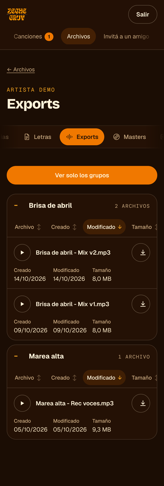

- **baja** · Difícil de tocar con el dedo · `button.tab «Mi proyecto»` — 103×40px (se recomienda 44×44).
- **baja** · Difícil de tocar con el dedo · `button.tab «Canciones1»` — 122×40px (se recomienda 44×44).
- **baja** · Difícil de tocar con el dedo · `button.tab.is-active «Archivos»` — 83×40px (se recomienda 44×44).
- **baja** · Difícil de tocar con el dedo · `button.tab «Invitá a un amigo»` — 137×40px (se recomienda 44×44).
- **baja** · Difícil de tocar con el dedo · `button.tab «Distribución»` — 105×40px (se recomienda 44×44).
- **baja** · Difícil de tocar con el dedo · `button.tab «Mi perfil»` — 79×40px (se recomienda 44×44).
- **baja** · Difícil de tocar con el dedo · `button «Referencias»` — 132×40px (se recomienda 44×44).
- **baja** · Difícil de tocar con el dedo · `button «Letras»` — 95×40px (se recomienda 44×44).
- **baja** · Difícil de tocar con el dedo · `button.is-active «Exports»` — 106×40px (se recomienda 44×44).
- **baja** · Difícil de tocar con el dedo · `button «Masters»` — 107×40px (se recomienda 44×44).
- **baja** · Difícil de tocar con el dedo · `button «Membresía»` — 127×40px (se recomienda 44×44).
- **baja** · Difícil de tocar con el dedo · `button.sort-btn «Archivo ↕»` — 83×36px (se recomienda 44×44).
- **baja** · Difícil de tocar con el dedo · `button.sort-btn «Creado ↕»` — 81×36px (se recomienda 44×44).
- **baja** · Difícil de tocar con el dedo · `button.sort-btn.is-active «Modificado ↓»` — 103×36px (se recomienda 44×44).
- **baja** · Difícil de tocar con el dedo · `button.sort-btn «Tamaño ↕»` — 85×36px (se recomienda 44×44).
- **baja** · Difícil de tocar con el dedo · `button.play-btn «Escuchar Brisa de abril - Mix v2.mp3»` — 40×40px (se recomienda 44×44).
- **baja** · Difícil de tocar con el dedo · `button.play-btn «Escuchar Brisa de abril - Mix v1.mp3»` — 40×40px (se recomienda 44×44).

### Masters — 15 hallazgos

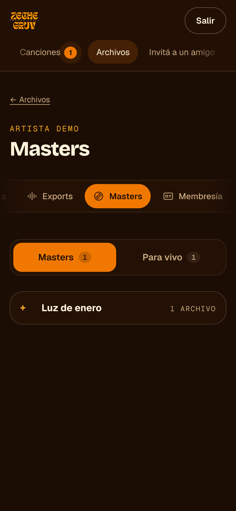

- **media** · Tapado por otro elemento · `button «Referencias»` — Lo tapa button «Letras».
- **baja** · Difícil de tocar con el dedo · `button.tab «Mi proyecto»` — 103×40px (se recomienda 44×44).
- **baja** · Difícil de tocar con el dedo · `button.tab «Canciones1»` — 122×40px (se recomienda 44×44).
- **baja** · Difícil de tocar con el dedo · `button.tab.is-active «Archivos»` — 83×40px (se recomienda 44×44).
- **baja** · Difícil de tocar con el dedo · `button.tab «Invitá a un amigo»` — 137×40px (se recomienda 44×44).
- **baja** · Difícil de tocar con el dedo · `button.tab «Distribución»` — 105×40px (se recomienda 44×44).
- **baja** · Difícil de tocar con el dedo · `button.tab «Mi perfil»` — 79×40px (se recomienda 44×44).
- **baja** · Difícil de tocar con el dedo · `button «Referencias»` — 132×40px (se recomienda 44×44).
- **baja** · Difícil de tocar con el dedo · `button «Letras»` — 95×40px (se recomienda 44×44).
- **baja** · Difícil de tocar con el dedo · `button «Exports»` — 104×40px (se recomienda 44×44).
- **baja** · Difícil de tocar con el dedo · `button.is-active «Masters»` — 109×40px (se recomienda 44×44).
- **baja** · Difícil de tocar con el dedo · `button «Membresía»` — 127×40px (se recomienda 44×44).
- **baja** · Difícil de tocar con el dedo · `button.sort-btn` — 83×36px (se recomienda 44×44). (×3)
- **baja** · Difícil de tocar con el dedo · `button.sort-btn.is-active` — 103×36px (se recomienda 44×44).
- **baja** · Difícil de tocar con el dedo · `button.play-btn «Escuchar Luz de enero - Master.wav»` — 40×40px (se recomienda 44×44).

### Distribución (lanzamientos) — 6 hallazgos

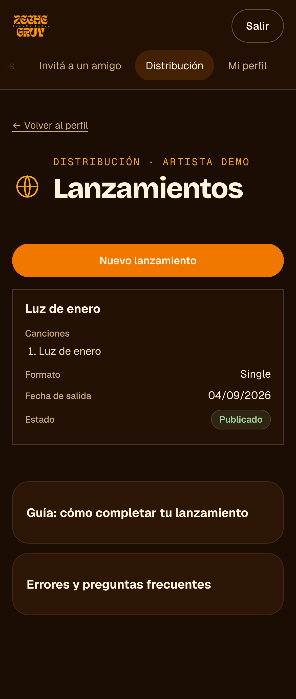

- **baja** · Difícil de tocar con el dedo · `button.tab «Mi proyecto»` — 103×40px (se recomienda 44×44).
- **baja** · Difícil de tocar con el dedo · `button.tab «Canciones1»` — 122×40px (se recomienda 44×44).
- **baja** · Difícil de tocar con el dedo · `button.tab «Archivos»` — 83×40px (se recomienda 44×44).
- **baja** · Difícil de tocar con el dedo · `button.tab «Invitá a un amigo»` — 137×40px (se recomienda 44×44).
- **baja** · Difícil de tocar con el dedo · `button.tab.is-active «Distribución»` — 105×40px (se recomienda 44×44).
- **baja** · Difícil de tocar con el dedo · `button.tab «Mi perfil»` — 79×40px (se recomienda 44×44).

### Nuevo lanzamiento (formulario) — 21 hallazgos

- **media** · Difícil de tocar con el dedo · `label «Título del lanzamiento»` — 320×17px (se recomienda 44×44).
- **media** · Difícil de tocar con el dedo · `label «Formato»` — 320×17px (se recomienda 44×44).
- **media** · Difícil de tocar con el dedo · `label «Fecha de salida»` — 320×17px (se recomienda 44×44).
- **media** · Difícil de tocar con el dedo · `label «Género»` — 320×17px (se recomienda 44×44).
- **media** · Difícil de tocar con el dedo · `label «Subgénero»` — 320×17px (se recomienda 44×44).
- **baja** · Texto muy chico · `div#coverEmpty.cover-preview.cover-empty «SIN PORTADA»` — Letra de 11px.
- **baja** · Texto muy chico · `span «MAIN ARTIST»` — Letra de 11px.
- **baja** · Texto muy chico · `span «FEATURING»` — Letra de 11px.
- **baja** · Texto muy chico · `span «COMPOSER»` — Letra de 11px.
- **baja** · Texto muy chico · `span «LYRICIST»` — Letra de 11px.
- **baja** · Texto muy chico · `span «SONGWRITER»` — Letra de 11px.
- **baja** · Texto muy chico · `span «PRODUCER»` — Letra de 11px.
- **baja** · Texto muy chico · `span «MIXER»` — Letra de 11px.
- **baja** · Texto muy chico · `span «MASTERING ENGINEER»` — Letra de 11px.
- **baja** · Texto muy chico · `span «REMIXER»` — Letra de 11px.
- **baja** · Difícil de tocar con el dedo · `button.tab «Mi proyecto»` — 103×40px (se recomienda 44×44).
- **baja** · Difícil de tocar con el dedo · `button.tab «Canciones1»` — 122×40px (se recomienda 44×44).
- **baja** · Difícil de tocar con el dedo · `button.tab «Archivos»` — 83×40px (se recomienda 44×44).
- **baja** · Difícil de tocar con el dedo · `button.tab «Invitá a un amigo»` — 137×40px (se recomienda 44×44).
- **baja** · Difícil de tocar con el dedo · `button.tab.is-active «Distribución»` — 105×40px (se recomienda 44×44).
- **baja** · Difícil de tocar con el dedo · `button.tab «Mi perfil»` — 79×40px (se recomienda 44×44).

### Invitá a un amigo — 6 hallazgos

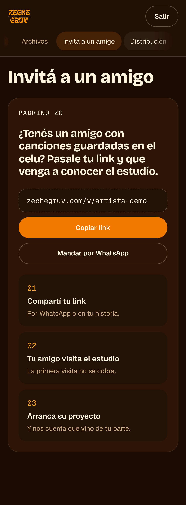

- **baja** · Difícil de tocar con el dedo · `button.tab «Mi proyecto»` — 103×40px (se recomienda 44×44).
- **baja** · Difícil de tocar con el dedo · `button.tab «Canciones1»` — 122×40px (se recomienda 44×44).
- **baja** · Difícil de tocar con el dedo · `button.tab «Archivos»` — 83×40px (se recomienda 44×44).
- **baja** · Difícil de tocar con el dedo · `button.tab.is-active «Invitá a un amigo»` — 137×40px (se recomienda 44×44).
- **baja** · Difícil de tocar con el dedo · `button.tab «Distribución»` — 105×40px (se recomienda 44×44).
- **baja** · Difícil de tocar con el dedo · `button.tab «Mi perfil»` — 79×40px (se recomienda 44×44).

### Mi perfil — 9 hallazgos

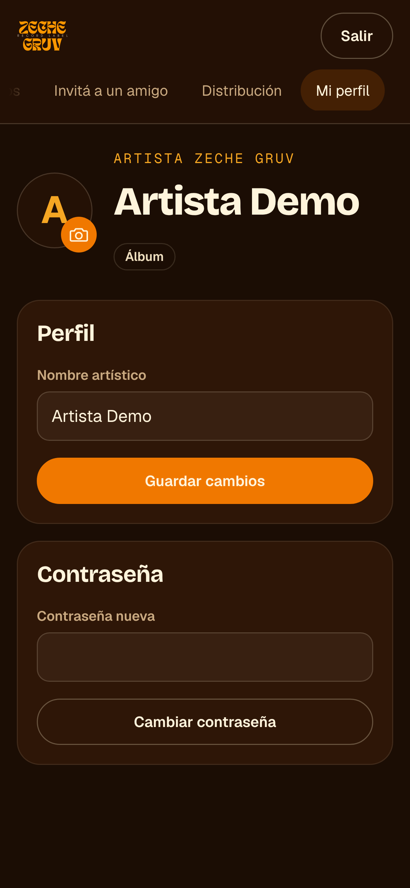

- **media** · Difícil de tocar con el dedo · `label «Nombre artístico»` — 320×17px (se recomienda 44×44).
- **media** · Difícil de tocar con el dedo · `label «Contraseña nueva»` — 320×17px (se recomienda 44×44).
- **baja** · Difícil de tocar con el dedo · `button.tab «Mi proyecto»` — 103×40px (se recomienda 44×44).
- **baja** · Difícil de tocar con el dedo · `button.tab «Canciones1»` — 122×40px (se recomienda 44×44).
- **baja** · Difícil de tocar con el dedo · `button.tab «Archivos»` — 83×40px (se recomienda 44×44).
- **baja** · Difícil de tocar con el dedo · `button.tab «Invitá a un amigo»` — 137×40px (se recomienda 44×44).
- **baja** · Difícil de tocar con el dedo · `button.tab «Distribución»` — 105×40px (se recomienda 44×44).
- **baja** · Difícil de tocar con el dedo · `button.tab.is-active «Mi perfil»` — 79×40px (se recomienda 44×44).
- **baja** · Difícil de tocar con el dedo · `button#photoBtn.avatar-change` — 34×34px (se recomienda 44×44).

